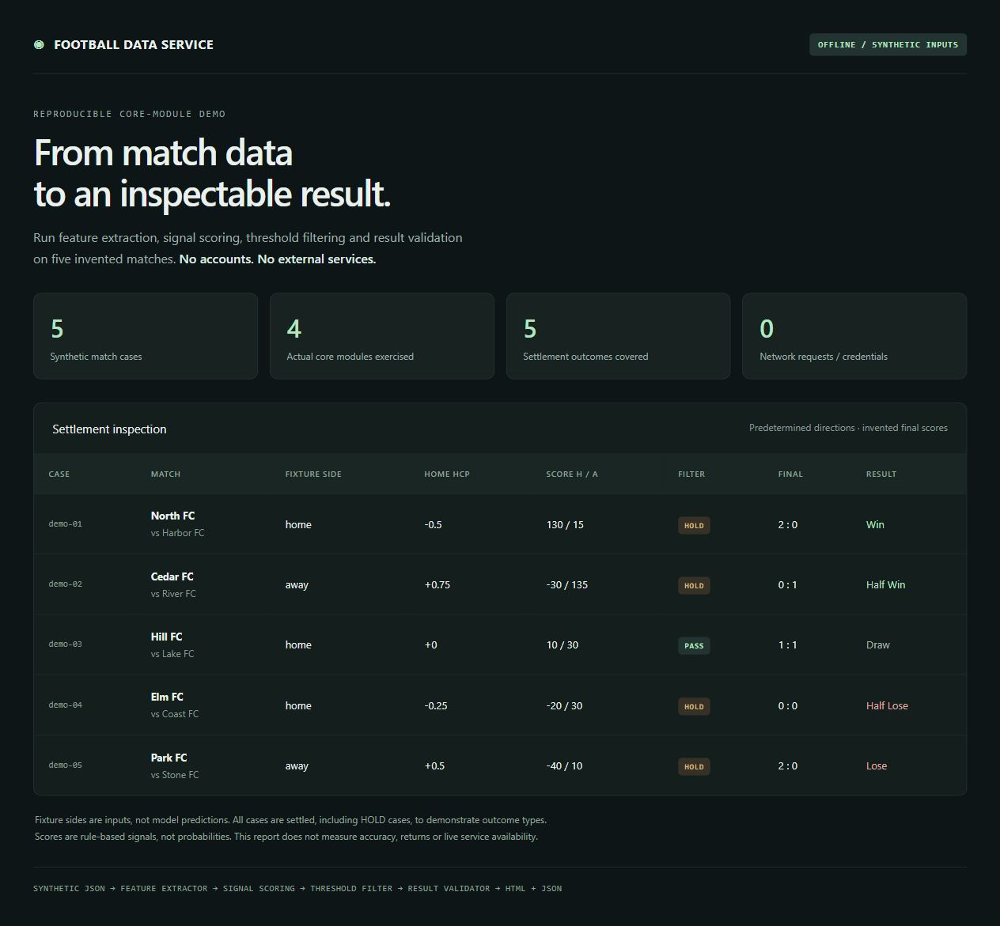

# Football Data Service

Football data collection, rule-based analysis, backtesting and notifications.

[](https://github.com/Kevin1777/football-public/actions/workflows/ci.yml)
[](LICENSE)

[简体中文](README.md) · **English** · [Quick start](docs/QUICKSTART.md) · [Releases](https://github.com/Kevin1777/football-public/releases)

## Purpose

Bring match lists, exchange data, handicaps and final scores into an inspectable workflow: collect, parse, extract features, score signals, validate results and optionally send notifications.

The source includes a Flask dashboard, Selenium clients, an X1 JSON engine, independent feature/scoring modules, SQLite tracking and WeCom / Telegram integrations. Scores are mainly rule-based signals, not large-language-model predictions or calibrated probabilities.

This is a sanitized source release of a previously private personal project. Public history starts on 2026-10-23 with a fresh root commit. Credentials, cookies, runtime databases, logs, third-party PDFs and virtual environments were excluded. See [maintenance and provenance](MAINTAINERS.md).

## Try it without accounts

Use Python 3.11 or 3.12. The offline example requires only the standard library.

```bash
git clone https://github.com/Kevin1777/football-public.git
cd football-public
python -m examples.offline_demo
```

Open `demo-output/index.html` and inspect `demo-output/results.json`. Five invented fixtures exercise the actual feature extractor, scoring model, threshold filter and result validator.



This is an offline example, not a screenshot of the full Flask application. Directions and final scores are predetermined fixture inputs. All cases are settled, including filtered cases, to cover the five outcome types. It demonstrates neither predictive accuracy nor returns.

## Implementation and verification

| Area | Included implementation | Public verification |
| --- | --- | --- |
| Features / scoring / filters / formatting | Rule signals, dynamic thresholds, hybrid results | Offline unit and property tests |
| Result validation | Handicap settlement and summary statistics | Offline tests and synthetic examples |
| Collection / parsing | Selenium, HTTP, HTML / PDF, batch collection | Online third-party flows not revalidated |
| Flask dashboard | Collection, file management and task routes | Full application startup / UI not revalidated |
| Backtesting / tracking | Caches, historical replay, SQLite, daily review | Requires your own data; historical metrics not reproduced |
| Scheduling / notifications | APScheduler, recovery, WeCom / Telegram | Requires credentials; real sends not revalidated |

Historical notes contain older performance claims. The underlying private dataset is not distributed, so those claims are not verified results of this public release.

## Full application setup

The inherited application dependency pins are old. Start with Python 3.11 / 3.12 in an isolated environment; full dependency installation, OCR and third-party site compatibility still need validation. Chrome / Chromium and an authorized data-source account are required for collection.

```bash
python3.12 -m venv .venv
.venv/bin/python -m pip install -r requirements.txt
cp .env.example .env
cp config/config.example.json config.json
cp config/wecom_config.example.json config/wecom_config.json
.venv/bin/python app.py
```

Configure your local files before starting. The expected address with the supplied `.env` is `http://127.0.0.1:5002`; scheduling starts disabled. Login configuration is read from the root `config.json`. See [quick start](docs/QUICKSTART.md) for Windows commands and limitations.

The management API includes file and task operations without a complete authentication layer. Use it on localhost or an isolated trusted network. Full application startup performs old-cache cleanup; back up existing research data first.

## Development

```bash
python -m pip install -r requirements-dev.txt
python -m pytest
python tools/check_public_release.py
```

The default suite selects offline core tests explicitly. It does not import the full app, authenticate to providers or send notifications. CI runs these checks on Windows / Ubuntu and Python 3.11 / 3.12. A passing run covers that scope only. See [testing](docs/TESTING.md) and [architecture](docs/ARCHITECTURE.md).

## Maintenance

Maintained by [@Kevin1777](https://github.com/Kevin1777). Contributions with small, reproducible examples are welcome.

- [Contributing](CONTRIBUTING.md) · [Maintenance evidence](MAINTAINERS.md)
- [Changelog](CHANGELOG.md) · [Roadmap](docs/ROADMAP.md) · [Security](SECURITY.md)
- [Legacy documentation](docs/README.md), mostly Chinese and potentially outdated

[MIT License](LICENSE). Third-party data, services and brands retain their own terms and rights.
