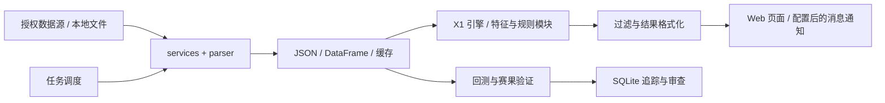

# Football Data Service

足球数据采集、规则分析、历史回测与消息通知工具。

[](https://github.com/Kevin1777/football-public/actions/workflows/ci.yml)
[](LICENSE)

**简体中文** · [English](README.en.md) · [快速开始](docs/QUICKSTART.md) · [公开版本](https://github.com/Kevin1777/football-public/releases) · [问题反馈](https://github.com/Kevin1777/football-public/issues)

## 解决什么问题

把比赛列表、成交明细、盘口和赛果整理到同一条分析流程：采集并解析数据，提取指标，生成可检查的规则评分，回看赛果，再按配置发送通知。适合研究数据解析、任务调度、规则引擎和回测流程的开发者。

项目包含 Flask 管理页面、Selenium 采集客户端、X1 JSON 引擎、独立的特征与评分模块、SQLite 追踪，以及企业微信 / Telegram 通知模块。评分主要来自规则和阈值，不应被理解为大模型预测或校准后的胜率。

这是从个人私有项目整理出的公开源码版本。首次公开时重新建立了干净的提交历史；旧凭据、Cookie、数据库、运行日志、第三方 PDF 和虚拟环境没有随源码发布。公开维护从 2026-10-23 开始，参见[维护记录与验证范围](MAINTAINERS.md)。

## 先体验：无需账号的离线演示

需要 Python 3.11 或 3.12；离线演示仅使用 Python 标准库，无需安装完整依赖。

```bash
git clone https://github.com/Kevin1777/football-public.git
cd football-public
python -m examples.offline_demo
```

打开生成的 `demo-output/index.html`，或查看 `demo-output/results.json`。输入在 [`examples/matches.synthetic.json`](examples/matches.synthetic.json)，包含五场虚构比赛，覆盖全赢、半赢、走水、半输、全输五类结果。


*截图来自本仓库离线演示的实际输出。它不是完整 Flask 管理端截图；样例方向和赛果为预设输入，评分和结算由核心模块计算，不能据此推导历史准确率或收益。*

## 已有能力与验证范围

| 模块 | 仓库中的实现 | 当前公开验证 |
| --- | --- | --- |
| 特征与规则分析 | 成交量、比例、热度、凯利、盘口变化；评分与动态阈值 | 离线单元 / 属性测试与合成演示 |
| 结果验证 | 主客方向、让球结算、统计汇总 | 离线单元 / 属性测试 |
| 数据采集与解析 | Selenium / HTTP、HTML / PDF、500 盘口、批量采集 | 保留源码；第三方在线链路待重新验收 |
| Web 管理 | Flask 路由、采集页面、数据管理、任务状态 | 保留实现；完整启动与浏览器流程待重新验收 |
| 回测与追踪 | 缓存、历史回放、SQLite 推荐记录、每日审查 | 需要用户自己的数据；公开版未复现历史性能 |
| 调度与消息通知 | APScheduler、恢复服务、企业微信 / Telegram | 需要配置凭据；未进行真实发送验收 |

旧文档和代码注释中存在早期回测数字；对应私有数据未发布，这些数字不是本次公开版本验证的性能承诺。

## 架构



离线演示调用独立的特征、评分、过滤和结果验证模块；完整应用使用的引擎入口与适配关系见[架构说明](docs/ARCHITECTURE.md)。

## 启动完整应用

完整应用沿用的依赖版本较旧，首次安装建议 Python 3.11 / 3.12 + 独立虚拟环境；完整依赖安装、OCR 和外站兼容性仍需验收。需要 Chrome / Chromium，采集需要自己的授权账号。

Windows PowerShell：

```powershell
py -3.12 -m venv .venv
.\.venv\Scripts\python -m pip install -r requirements.txt
Copy-Item .env.example .env
Copy-Item config/config.example.json config.json
Copy-Item config/wecom_config.example.json config/wecom_config.json
.\.venv\Scripts\python app.py
```

编辑本地配置后访问 `http://127.0.0.1:5002`。`.env.example` 默认关闭调度器，以便先检查页面和配置。根目录 `config.json` 是登录模块实际读取的路径。Linux 安装步骤、运行目录与常见问题见[快速开始](docs/QUICKSTART.md)。

管理接口包含文件、任务和日志操作，目前没有完整的身份认证层；应在本机或可信隔离网络中使用。完整应用启动时会执行旧缓存清理，已有研究数据应先备份。

## 开发与自动检查

```bash
python -m pip install -r requirements-dev.txt
python -m pytest
python tools/check_public_release.py
```

默认测试只收集明确选定的离线核心测试；不启动 Web 服务，不登录数据源，也不发送消息。[GitHub Actions](https://github.com/Kevin1777/football-public/actions) 在 Windows / Ubuntu、Python 3.11 / 3.12 上运行同一组检查。绿色 CI 表示该范围通过，不代表线上采集和预测效果已验收。详见[测试说明](docs/TESTING.md)。

## 维护与参与

- [贡献指南](CONTRIBUTING.md)：开发流程、测试边界和问题反馈。
- [维护记录](MAINTAINERS.md)：维护者、首次公开来源与当前验证证据。
- [更新记录](CHANGELOG.md) · [路线图](docs/ROADMAP.md) · [安全说明](SECURITY.md)。
- [历史文档索引](docs/README.md)：保留早期设计与使用笔记，其中路径和指标可能已过时。

维护者：[@Kevin1777](https://github.com/Kevin1777)。欢迎提交可复现的问题、解析样例和小范围改进。源码采用 [MIT License](LICENSE)；第三方服务、数据和品牌各自的权利不因本项目许可证而改变。
