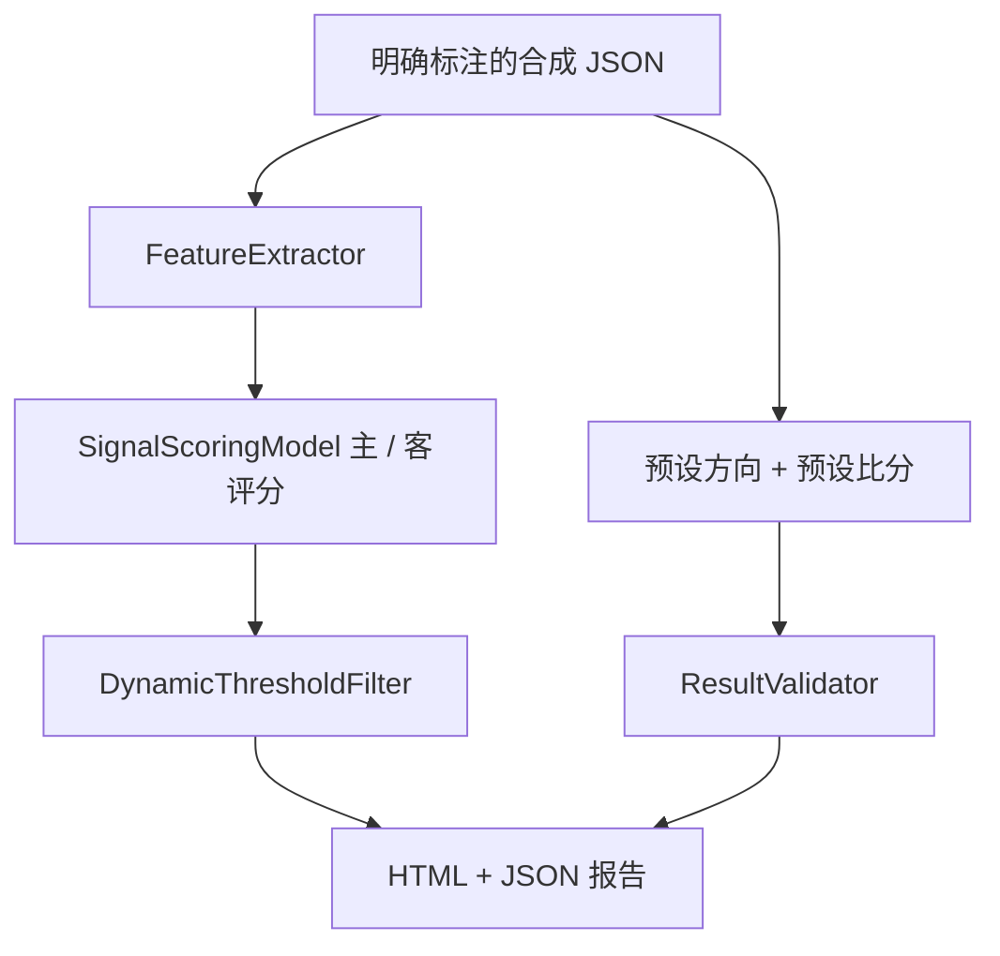

# Architecture and boundaries

## 完整应用

`app.py` 是 Flask 入口，包含页面、采集、文件、后台任务、推送和日志 API。它有较多导入期及启动期初始化，因此默认离线测试不会导入这个文件。

| 目录 / 文件 | 主要职责 |
| --- | --- |
| `services/` | 数据源客户端、Selenium、OCR、批量 / 后台采集、清理 |
| `parser/` | HTML、PDF、明细和交易数据解析 |
| `recommendation/x1_json_recommender.py` | 完整应用导入的 X1 JSON 推荐入口 |
| `recommendation/feature_extractor.py`、`scoring_model.py`、`threshold_filter.py` | 独立特征、评分和过滤组件 |
| `recommendation/hybrid_recommender.py`、`bet_type_selector.py`、`result_formatter.py` | 混合输出、类型选择和格式化 |
| `recommendation/result_validator.py` | 赛果与让球结果验证 |
| `core/`、`automation/` | 调度、推荐追踪、SQLite 和每日审查 |
| `backtest/` | 历史回放、缓存、进度和恢复 |
| `notification/` | 企业微信和 Telegram 消息 |
| `templates/`、`static/` | Flask 页面和样式 |

上述模块存在多代实现；独立组件测试通过不表示所有组件已经通过完整 Flask 路径集成。`app.py` 直接导入 X1 引擎，也导入根目录 `rule_based_recommender.py`；`core/engine_adapters/` 另有适配层，后续需要统一和补集成测试。

## 离线演示

过滤结果与结算结果在报告中独立展示。被过滤的样例也计算结算，以覆盖五种结果类型；这不是一份自动推荐的收益报告。让球值始终从主队视角表示，客队方向由验证器转换。

演示和默认测试不调用完整应用、账号登录、第三方采集、真实通知或后台任务。演示页面本身使用本地 HTML / CSS，不请求 CDN。

## 数据与版本

- 私有数据、SQLite、Cookie、实际配置和日志不发布。
- 原应用标识为 `v2.1.3`，模型代码还存在 `V7.2` 等独立标签；公开预览使用 `v2.1.3-public.N`。
- 老文档中的路径、完成声明和历史回测数字保留作为开发记录，不等同于公开版验证结果。
